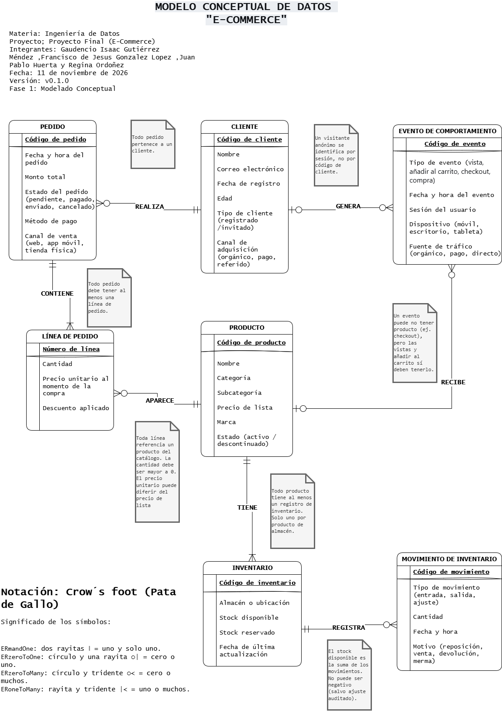
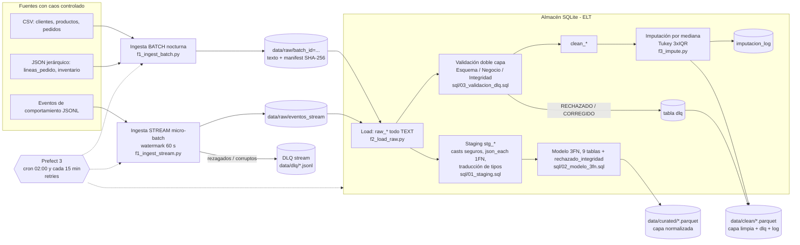
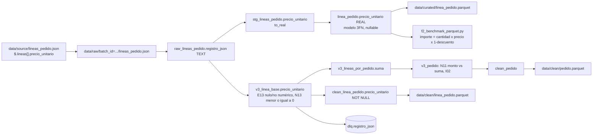

# Blueprint de Arquitectura y Gobernanza
## Arquitectura de Datos Híbrida y Resiliente para E-commerce

**Materia:** Ingeniería de Datos · **Fecha:** 30 de noviembre de 2026
**Equipo:** Regina Cosette Ordoñez Pinedo, Juan Pablo Huerta Gonzalez, Francisco de Jesus Gonzalez Lopez, Gaudencio Isaac Gutiérrez Méndez
**Repositorio:** github.com/cosette212/Ingenieria-Datos-Proyecto_E-commerce

---

## 1. Resumen ejecutivo

**Problema.** Una tienda en línea recibe pedidos, clientes, productos, inventario y eventos de navegación que llegan sucios, tarde y en formatos distintos: nulos, valores extremos, tipos mezclados (`"100"` frente a `100`), duplicados y eventos retrasados. El resultado son cruces rotos, reportes poco confiables y consultas lentas.

**Solución.** Un pipeline *end-to-end* con dos vías de ingesta (Batch nocturno y Stream por micro-lotes con watermark) bajo paradigma **ELT** sobre SQLite. Los datos se normalizan a 3FN, pasan por un escudo de validación de doble capa con Dead Letter Queue (DLQ), se imputan con mediana y se publican en Apache Parquet. Prefect 3 orquesta el flujo con política de reintentos.

**Resultados y evidencia** (corrida reproducida sobre los datos de `data/source/`):

| Indicador | Resultado | Evidencia |
|---|---|---|
| Registros de origen con problema propio | 202 de 2,752 (7.3 %); mínimo exigido 5 % | `src/f3_validate.py`, `docs/Fase3/fase3_validacion_dlq_imputacion.md` §5 |
| Join roto (texto vs entero) | 4,927 → 4,947 líneas con producto (+20 rescatadas) | `src/f2_validate_phase2.py`, `docs/Fase 2/fase2_elt_normalizacion_parquet.md` §4 |
| Integridad referencial | 0 referencias rotas (`PRAGMA foreign_key_check`) | `src/f2_validate_phase2.py` |
| Chaos Test | 34 casos inyectados, 52 comprobaciones | `src/f3_chaos_test.py` |
| Verificación de cadena | 69 de 69 comprobaciones aprobadas, incluidas las 8 de Parquet | `src/f3_verificar_cadena.py` |
| Parquet frente a CSV | consultas 17x a 23x más rápidas; 10x menos espacio (3.0 MB frente a 29.8 MB) | `docs/Fase 2/benchmark_resultado.md` |
| Orquestación | 11 tareas, corrida completa en 47 s (una corrida manual con fallo simulado) | `src/f4_orchestrator.py`, captura de Prefect |

---

## 2. Modelo conceptual y arquitectura

### 2.1 Modelo conceptual (independiente de la tecnología)

Siete entidades, notación pata de gallo (`docs/Fase1/modelo_conceptual.md`, diagrama en `docs/Fase1/modelo_conceptual_ecommerce.drawio.png`): CLIENTE, PRODUCTO, PEDIDO, LÍNEA DE PEDIDO, EVENTO DE COMPORTAMIENTO, INVENTARIO y MOVIMIENTO DE INVENTARIO.

Reglas de negocio R1–R7: todo pedido tiene cliente (R1) y al menos una línea (R2); el visitante anónimo se identifica por sesión (R3); vistas y carritos exigen producto (R4); la línea referencia un producto del catálogo con cantidad > 0 (R5); un registro de inventario por producto y almacén (R6); el stock no es negativo (R7).

En siguiente figura, la relación entre el stock y la suma de los movimientos representa una regla del modelo conceptual. En la implementación se comprobó que el stock fuera mayor o igual a cero. La conciliación entre el saldo registrado y el historial de movimientos quedó fuera de las validaciones realizadas con los datos sintéticos.

**Figura 1 · Modelo conceptual del e-commerce**

*Cada pedido pertenece a un cliente y sus líneas identifican los productos comprados.*

### 2.2 Diagrama de arquitectura

### 2.3 Recorridos

**Batch** (`src/f1_ingest_batch.py`). Lee CSV y JSON como texto (`dtype=str`), los aterriza sin limpiar en `data/raw/batch_id=AAAAMMDD_HHMMSS/` con `manifest.json` (conteos, SHA-256, estado). Un archivo fallido no detiene a los demás y el script sale con código 1 para activar el Retry.

**Stream** (`src/f1_stream_simulator.py`, `src/f1_ingest_stream.py`). Watermark = mayor `event_time` visto − 60 s. Los eventos por debajo del watermark van a `data/dlq/eventos_rezagados.jsonl`; el JSON roto o sin fecha va a `eventos_corruptos.jsonl`. El flujo nunca se detiene por un evento malo. El simulador genera 78 % de eventos casi inmediatos, 14 % con 10–50 s de retraso y 8 % con 90–600 s, y corrompe el 3 % de las líneas.

**ELT.** Los datos crudos se cargan primero y la transformación ocurre en el almacén con SQL, repetible sin volver al origen (idempotente por *full refresh*).

**Normalización.** 1FN: `json_each` desanida listas en `linea_pedido`, `inventario` y `movimiento_inventario`. 2FN: llave compuesta `(id_pedido, numero_linea)`. 3FN: `categoria` y `subcategoria` se separan de `producto` para eliminar `id_producto → subcategoria → categoria`.

**Validación y DLQ.** Tres capas: esquema (E01–E26), negocio (N01–N25) e integridad (I01–I08). Dos acciones: RECHAZADO (los hechos: pedidos, líneas, inventario, movimientos, eventos) y CORREGIDO (atributos descriptivos de maestros, que se ponen en NULL y se imputan). Un pedido con una línea inválida se rechaza completo (I02) y sus otras líneas quedan como I04.

**Imputación.** Mediana para `clean_cliente.edad` y `clean_producto.precio_lista`; outliers por Tukey 3×IQR (sobre logaritmo en el precio). KNN se descartó: las columnas no se relacionan entre sí en los datos generados.

**Salidas Parquet.** `data/curated/` (capa normalizada, 10 tablas) y `data/clean/` (capa validada e imputada, más `dlq`, `imputacion_log` y `dlq_auditoria.csv`). Muestra de 100 filas en CSV, JSON y Parquet en `data/sample/`.

---

## 3. Calidad y resiliencia

### 3.1 Chaos Test

`src/f3_chaos_test.py` copia el batch más reciente a `data/raw/batch_id=chaos_test`, inyecta **34 casos** (tipos erróneos como edad `'abc'` o precio `'gratis'`, edades −5 / 17 / 250, nulos, pedido sin líneas, monto negativo, stock negativo, eventos incompletos, cliente inexistente), corre el pipeline real y hace **52 comprobaciones**: 34 casos en la DLQ con su regla, 8 imputaciones, 5 registros que deben quedar limpios y 5 que no. Por defecto restaura el estado; `--mantener` deja los datos para la demo.

Ejecutamos el Chaos Test en una copia del proyecto con el comando `python src/f3_chaos_test.py`. El pipeline continuó procesando los datos y todos los casos de prueba tuvieron el resultado esperado.

Al retirar los datos inyectados, los cinco scripts de restauración terminaron con código 0, incluida la exportación de la capa limpia a Parquet. El verificador confirmó que los conteos finales coincidieron con los registrados antes de la inyección.

**Figura 2 · Resultado del Chaos Test**
Ruta: `docs/screenshots/screenshots fase 3/f3_chaos_test_restauracion.png`

*El pipeline procesó los datos de prueba con los resultados esperados. Tras retirar los registros inyectados, los conteos de la capa limpia, la DLQ y la bitácora de imputación coinciden con los de la línea base.*

### 3.2 DAG de Prefect

`src/f4_orchestrator.py` define dos flujos: `ecommerce-pipeline-end-to-end` (11 tareas: F1.1 a F3.4) y `ecommerce-stream-microbatch` (simulador y stream). Los despliegues están en `prefect.yaml`: `batch-nocturno-completo` (`0 2 * * *`, America/Mexico_City) y `stream-microbatch-continuo` (`*/15 * * * *`), versión 0.5.0.

**Figura 3 · DAG**
Ruta: `docs/screenshots/screenshots fase 4/Captura 1 Grafo DAG completo y dependencias.png`

*Ejecución `splendid-squirrel` del flujo `ecommerce-pipeline-end-to-end`: 11 tareas completadas en 47 s, con las dependencias Batch/Stream → ELT → Parquet → Validación/DLQ → Imputación → Verificación.*

El flujo completo recibe datos por dos vías de ingesta, Batch y Stream. Prefect ejecuta las tareas en secuencia y continúa con la carga en SQLite, la transformación, la validación y la exportación de los datos.

Las etiquetas finops-offpeak y realtime identifican el flujo nocturno y el de eventos, respectivamente. La configuración del proyecto no establece un orden de prioridad entre ambos.

En el entorno mostrado en la captura, los despliegues utilizan el grupo de trabajo local-process-pool. El archivo prefect.yaml define los horarios de Batch y Stream y omite el nombre del grupo.

### 3.3 Reintento ante fallo temporal

`python src/f4_orchestrator.py --simular-fallo` lanza un `ConnectionError` controlado en el primer intento de `F2.1 - Carga Raw a Almacén ELT` (variable `_INTENTOS_SIMULADOS`). Prefect lo reintenta tras 5 s y la tarea termina bien en el intento 2.

**Figura 4 · Retry**
Ruta: `docs/screenshots/screenshots fase 4/Captura 2.2 Evidencia de la politica Retry ante fallo temporal.png`

*Registro de `F2.1` con el aviso "[CAOS OPERATIVO]", el `ConnectionError`, "Retry 1/3 will start 5 second(s) from now" y `Run Count 2`, hasta completarse.*

El fallo se simuló antes de iniciar la carga de datos. Tras el primer intento fallido, Prefect esperó cinco segundos y la tarea F2.1 terminó correctamente en el segundo intento. La política de reintentos se configura por tarea. En este proyecto, los límites varían entre dos y tres reintentos, con esperas de tres o cinco segundos.

---

## 4. Batch frente a Stream

### 4.1 Comparación

| Dimensión | Batch | Stream (micro-batch) | Fuente |
|---|---|---|---|
| Frecuencia | 1 corrida/día, 02:00 → 30 al mes | cada 15 min → 96 al día, 2,880 al mes | `prefect.yaml` |
| Datos | CSV y JSON (clientes, productos, pedidos, líneas, inventario) | eventos de comportamiento | `docs/Fase1/arquitectura_ingesta.md` §6 |
| Frescura en raw | La ingesta batch está programada una vez al día, a las 02:00 | La ingesta de eventos está programada cada 15 min. Cada ejecución aplica un watermark de 60 s para identificar eventos tardíos | `prefect.yaml`, `src/f1_ingest_stream.py` |
| Frescura en la capa analítica | El flujo nocturno completo actualiza los archivos Parquet | Los eventos aceptados quedan en raw hasta que el flujo completo los procesa y publica en Parquet | `src/f4_orchestrator.py` |
| Cómputo por corrida | pipeline completo (*full refresh*) | simulador + ingesta ligera | código |
| Etiqueta del despliegue | baja (`finops-offpeak`) | alta (`realtime`) | `prefect.yaml` (solo etiquetas) |

### 4.2 Costos

**No hay costos medidos.** Lo disponible es una estimación ilustrativa del repo (`docs/Fase1/arquitectura_ingesta.md` §6): servidor 24/7 = 720 h/mes frente a batch con ventana de 1 h = 30 h/mes, una reducción de horas de 95.8 %. Con 0.10 USD/h ilustrativos son 72 USD frente a 3 USD. El precio no corresponde a un proveedor.

Tiempo real observado: una corrida completa manual tardó 47 s, incluidos ~6 s del simulador y 5 s de espera del Retry. Es una sola observación, no un benchmark.

Para completar con datos: `Costo_mensual ≈ nº de corridas × duración media × tarifa`; el nº de corridas es 30 (batch) y 2,880 (stream). Falta medir la duración de cada flujo por separado.

La estimación supone un mes de 30 días y cómputo facturado únicamente durante una hora diaria para el batch. Los importes de 72 USD y 3 USD ilustran ese escenario con una tarifa de 0.10 USD por hora. El equipo no midió el costo mensual de los despliegues.

La configuración de Prefect programa el flujo completo a las 02:00 y la ingesta de eventos cada 15 minutos. Durante una ejecución, el simulador genera un microlote aproximadamente cada dos segundos.

**Figura 5 · Despliegues programados**
Ruta: `docs/screenshots/screenshots fase 4/Captura 3.1 Toma la captura final de los despliegues programados cada 15 min.png`

*Configuración del despliegue stream-microbatch-continuo en Prefect. La interfaz muestra un intervalo de 15 minutos y cero ejecuciones registradas al momento de la captura.*

### 4.3 Resultado aparte: benchmark CSV frente a Parquet

Histórico simulado de 484,500 filas (4,845 líneas reales × 100 copias), 365 CSV (uno por día) frente a un solo Parquet (snappy); mediana de 3 corridas; Windows 11, Python 3.12.5. Resultados idénticos entre formatos.

| Consulta | CSV (s) | Parquet (s) | Veces más rápido |
|---|---:|---:|---:|
| A. Lectura completa (10 columnas) | 1.12 | 0.05 | 23.0x |
| B. Top 5 productos por importe (4 columnas) | 0.77 | 0.05 | 17.0x |
| C. Unidades por mes (2 columnas) | 0.88 | 0.04 | 21.0x |

Tamaño: CSV 29.8 MB (365 archivos) frente a Parquet 3.0 MB (1 archivo), relación 10.0x. Fuente: `docs/Fase 2/benchmark_resultado.md`, `src/f2_benchmark_parquet.py`.

En la prueba documentada por el equipo, las tres consultas devolvieron los mismos resultados con ambos formatos. Sobre un histórico simulado de 484,500 filas, las consultas en Parquet fueron entre 17 y 23 veces más rápidas. Cada tiempo corresponde a la mediana de tres ejecuciones. Los factores de aceleración se calcularon antes de redondear los tiempos que aparecen en la tabla.

**Figura 6 · Benchmark**
Ruta: `docs/screenshots/screenshots fase 2/Prueba_Comparativa_(Benchmark), img2.jpg`

*Tiempos de las tres consultas en CSV y Parquet, con 17x a 23x de aceleración, 10.0x de ahorro de espacio y resultados idénticos entre formatos.*

---

## 5. Gobernanza

### 5.1 Linaje de la columna `precio_unitario`

Archivos: `sql/01_staging.sql`, `sql/02_modelo_3fn.sql`, `sql/03_validacion_dlq.sql` (reglas E13, N13, N11, I02, I04), `src/f2_benchmark_parquet.py`. `f3_impute.py` no toca esta columna: un precio nulo no se imputa, se rechaza.

### 5.2 Análisis de impacto: "si se renombra o elimina `precio_unitario` en el origen"

Probado ejecutando el pipeline con la clave renombrada en `lineas_pedido.json`:

| Capa | Efecto observado |
|---|---|
| Raw | Sin error: es texto JSON |
| Staging y 3FN | Sin error: `json_extract` devuelve NULL; las 4,907 líneas del modelo 3FN quedan con precio NULL |
| Validación de la Fase 2 | Sigue pasando 10/10: no revisa precios |
| Escudo de la Fase 3 | 4,956 líneas rechazadas (E13) y 1,989 pedidos rechazados (I02); los 11 pedidos sin líneas ya iban por N10; no aparece I04 porque toda línea es inválida por sí misma |
| Capa limpia | `clean_pedido` y `clean_linea_pedido` quedan vacías |
| Otras entidades | Sin cambio: clientes 500, productos 100, inventario 141, movimientos 324 |
| Salidas | `data/clean/linea_pedido.parquet` y `pedido.parquet` vacíos; `data/curated/linea_pedido.parquet` con precio NULL; el benchmark descarta las filas con precio nulo |
| "Reportes finales" | El repo no contiene reportes ni tableros: se entienden como los Parquet de salida y las consultas del benchmark (importe, top 5 productos) |

Al renombrar precio_unitario en el JSON de origen, la carga continuó y la extracción en staging devolvió NULL para ese campo. La validación de la fase 3 rechazó las 4,956 líneas por falta de precio (E13) y los 1,989 pedidos que contenían esas líneas (I02). Los otros 11 pedidos ya se rechazaban por carecer de líneas (N10). Como resultado, las tablas limpias de pedidos y líneas quedaron vacías. Las tablas de clientes y productos conservaron sus registros.

**Qué iría a la DLQ con los datos actuales.** 21 líneas tienen `precio_unitario` nulo en la fuente (por ejemplo, 107-1, 221-1, 354-1): 21 filas E13 (RECHAZADO), 21 filas I02 de sus pedidos y filas I04 para las otras líneas válidas de esos pedidos. No hay líneas con precio ≤ 0 (N13 no se dispara). Si el problema fuera `precio_lista` (otra columna, en `producto`), el registro se CORRIGE e imputa en vez de rechazarse.

### 5.3 Catálogo de datos: vista de referencia (negocio)

| Dominio / entidad | Descripción de negocio | Identificador | Reglas de calidad | Criticidad (según `f5_gobernanza.py`) |
|---|---|---|---|---|
| Cliente | Persona que compra, registrada o invitada | `id_cliente` | edad 18–100, correo válido, sin duplicados | Alta |
| Producto | Artículo a la venta con categoría, subcategoría y precio de lista | `id_producto` | precio de lista > 0, estado activo/descontinuado | Media |
| Pedido | Transacción de compra; hecho central | `id_pedido` | R1, R2, monto > 0, monto = suma de líneas (±0.50) | Crítica |
| Línea de pedido | Detalle de producto en un pedido | `(id_pedido, numero_linea)` | R5, cantidad > 0, precio unitario > 0, descuento 0–1 | Sin clasificar |
| Evento de comportamiento | Acción del usuario en el sitio | `id_evento` | R3, R4, tipo válido | Media |
| Inventario | Stock por producto y almacén | `id_inventario` (sustituta) | R6, R7 | Sin clasificar |
| Movimiento de inventario | Historial de cambios de stock | `id_movimiento` | cantidad > 0, tipo válido | Sin clasificar |

El catálogo agrupa los datos por dominio de negocio. Por ejemplo, el dominio clientes corresponde a la entidad Cliente y el dominio eventos_stream a Evento de comportamiento. La documentación del proyecto deja pendiente la asignación de responsables por dominio.

### 5.4 Catálogo de datos: vista operativa

| Objeto | Capa / formato | Ubicación | Productor | Conteos y observaciones | Permiso documentado |
|---|---|---|---|---:|---|
| `raw_*` | Cruda, SQLite TEXT | `data/warehouse/tienda_dwh.db` (no versionado) | `f2_load_raw.py` | 505 / 100 / 2,000 / 2,000 JSON / 100 JSON | — |
| `stg_*` | Staging, SQLite | mismo almacén | `sql/01_staging.sql` | 4,956 líneas | — |
| `cliente`, `pedido`, `linea_pedido`, … | Modelo 3FN, SQLite | mismo almacén | `sql/02_modelo_3fn.sql` | 500 / 1,987 / 4,907 | clientes y pedidos: read-write; productos: read-only |
| `data/curated/*.parquet` | Parquet snappy | `data/curated/` | `f2_export_parquet.py` | 10 archivos: cliente 500, pedido 1,987, linea_pedido 4,907, rechazado_integridad 62 | — |
| `clean_*` y `data/clean/*.parquet` | Parquet snappy | `data/clean/` | `f3_export_clean.py` | línea base: cliente 500, pedido 1,832, línea 4,564 (Fase 3) | — |
| `dlq`, `dlq_auditoria.csv` | SQLite / Parquet / CSV | `data/clean/` | `f3_validate.py` | 650 registros en dlq.parquet | — |
| `imputacion_log` | SQLite / Parquet | `data/clean/` | `f3_impute.py` | 27 registros en imputacion_log.parquet | — |
| DLQ del stream | JSONL | `data/dlq/` (no versionado) | `f1_ingest_stream.py` | aleatorio por corrida | — |
| `eventos_stream` | Cruda, JSONL | `data/raw/eventos_stream/` | `f1_ingest_stream.py` | aleatorio por corrida | eventos: read-only |

La línea base documentada en la fase 3 contiene 500 clientes, 1,832 pedidos y 4,564 líneas de pedido en la capa limpia. Los archivos data/clean/ del repositorio incluyen registros de prueba del Chaos Test y contienen 507 clientes, 1,833 pedidos y 4,565 líneas. Los conteos de la DLQ y de la bitácora de imputación que aparecen en esta tabla corresponden a esos archivos del repositorio.

### 5.5 Permisos: documentados frente a verificables

| Permiso | Estado |
|---|---|
| clientes read-write, productos read-only, pedidos read-write, eventos_stream read-only | **Documentado** únicamente como texto fijo en `src/f5_gobernanza.py` y de forma genérica en `docs/Fase5` |
| Aplicación real de esos permisos | **No verificable en el repo**: SQLite no tiene roles; todos los scripts abren el almacén con acceso completo; no hay ACL ni configuración de accesos |
| Qué significa "read-only" y para quién | **No definido** (el pipeline modifica `clean_producto` al imputar) |

### 5.6 Versionado semántico

El README planifica `v0.1.0` (modelo conceptual) a `v0.5.0` (orquestación) y `v1.0.0` (entrega); los documentos de fase llevan v0.1.0 a v0.4.0 y `prefect.yaml` usa 0.5.0. 

La etiqueta `v1.0.0` está publicada en GitHub y apunta al commit `feat(fase5): agregar gobernanza, linaje y script de reporte f5`, con el que el equipo cerró la fase 5.