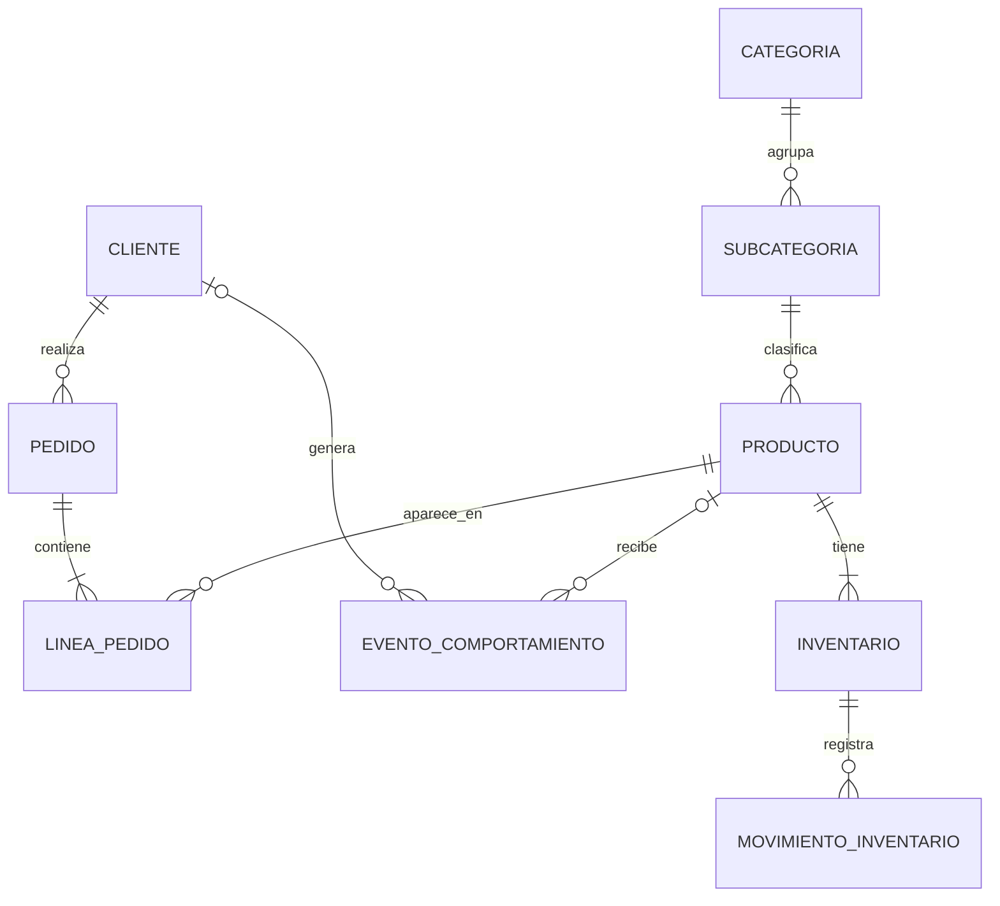

# Fase 2 "ELT", Normalización y Almacenamiento Analítico

Versión: v0.3.0 · Integrantes: Gaudencio Isaac Gutiérrez Méndez, Juan Pablo Huerta Gonzalez, Francisco de Jesus Gonzalez Lopez y Regina Cosette Ordoñez Pinedo

## 1. Paradigma elegido: ELT

La arquitectura opera bajo **ELT**. Los datos crudos se cargan primero en el almacén destino y **el motor SQL del almacén hace la transformación** (casts, desanidado de JSON, normalización, llaves y restricciones).

| Capa | Dónde vive | Qué contiene | Quién la crea |
|---|---|---|---|
| Fuente | `data/source/` | CSV y JSON con caos controlado | `f1_generate_chaos_data.py` |
| Cruda (raw) | `data/raw/` y tablas `raw_*` | Copia fiel, todo como texto, JSON con listas anidadas | `f1_ingest_batch.py`, `f1_ingest_stream.py`, `load_raw.py` |
| Staging | tablas `stg_*` | Tipos correctos, JSON desanidado (1FN), ids traducidos | `sql/01_staging.sql` |
| Modelo normalizado (3FN) | tablas finales | Llaves primarias y foráneas, sin redundancia | `sql/02_modelo_3fn.sql` |
| Analítica | `data/curated/*.parquet` | Capa histórica columnar | `export_parquet.py` |

**Por qué ELT y no ETL:**
- La transformación se expresa en SQL, se ejecuta dentro del almacén y se puede volver a correr cuando cambian las reglas, sin volver a pedir datos al origen.
- Los datos crudos quedan intactos y auditables; si una transformación estaba mal, se corrige y se repite.
- Lo que no cumple integridad no se pierde: se guarda en `rechazado_integridad`.
- El pipeline es **idempotente**: correrlo dos veces produce el mismo resultado (full refresh).

## 2. Normalización (1FN → 3FN)

| Forma normal | Problema encontrado en la fuente | Solución aplicada | Evidencia |
|---|---|---|---|
| **1FN** | Cada pedido traía una **lista** de líneas dentro de una celda; cada producto traía una lista de almacenes y cada almacén una lista de movimientos | Se desanidan con `json_each` en `linea_pedido`, `inventario` y `movimiento_inventario`: una fila por elemento | `validate_phase2.py`, sección 1 |
| **2FN** | Las líneas dependen del pedido **y** del número de línea | Llave compuesta `(id_pedido, numero_linea)`; todos sus atributos dependen de la llave completa. Inventario usa llave sustituta `id_inventario` y restricción `UNIQUE (id_producto, almacen)` | DDL en `02_modelo_3fn.sql` |
| **3FN** | En `producto`, la categoría dependía de la subcategoría, no del producto: `id_producto → subcategoria → categoria` (dependencia transitiva) | Se separa en `categoria` y `subcategoria`; `producto` solo guarda `id_subcategoria` | `validate_phase2.py`, sección 5 |

**Observaciones de diseño:**
- `pedido.monto_total` es un dato **derivado** (suma de sus líneas). Se conserva porque viene de la fuente y la Fase 3 validará que coincida con las líneas.
- Los productos sin categoría en la fuente la recuperan a través de su subcategoría: un beneficio directo de normalizar.
- Almacén sigue como atributo de `inventario` (decisión del modelo conceptual: un solo atributo, sin entidad aparte).

## 3. Modelo lógico



(GitHub dibuja este diagrama automáticamente al abrir el archivo.)

## 4. Reto del Join Roto

| Dónde ocurre | Tipo en el origen | Tipo en el almacén | Regla de traducción |
|---|---|---|---|
| `lineas_pedido.json` → `producto_id` | **Texto** (`"105"`, a veces `" 105 "`) | `producto.id_producto` **entero** | `to_int()`: quita espacios y convierte a entero; si no se puede, devuelve `NULL` |
| `inventario.json` → `producto_id` | Texto | Entero | Misma regla |
| Eventos del stream → `producto_id` | Texto | Entero | Misma regla |

**Evidencia**

| Medición | Valor |
|---|---|
| Join comparando el texto tal cual | 4927 líneas con producto |
| Join con el tipo traducido a entero | 4947 líneas con producto |
| Líneas rescatadas por la traducción | 20 |

Los ids que no existen en el catálogo (por ejemplo `"999"`) no rompen el flujo: la línea se guarda en `rechazado_integridad` con el motivo `producto_inexistente_o_nulo`.

## 5. Integridad referencial

- Todas las relaciones del modelo tienen `FOREIGN KEY`.
- `PRAGMA foreign_key_check` devuelve **cero** referencias rotas.
- Los registros que no entran (cliente inexistente, producto inexistente, líneas de un pedido rechazado) quedan en `rechazado_integridad` con tabla, clave, motivo y detalle. Es el antecedente de la Dead Letter Queue de la Fase 3.
- Las reglas de **negocio** (edades válidas, montos positivos, pedido con al menos una línea) y la imputación estadística corresponden a la Fase 3.

## 6. Almacenamiento analítico: Apache Parquet

Parquet guarda los datos **por columnas**, comprimidos y con tipos. Una consulta lee solo las columnas que necesita, mientras que un CSV obliga a leer y convertir todas las filas completas, y además un histórico en CSV suele estar repartido en muchos archivos.

**Prueba comparativa:** `src/benchmark_parquet.py` construye un histórico simulado (~485 mil filas) y lo guarda como 365 CSV (uno por día) y como un solo Parquet.

| Consulta | CSV (s) | Parquet (s) | Veces más rápido |
|---|---:|---:|---:|
| A. Lectura completa (10 columnas) | 1.12 | 0.05 | 23.0x |
| B. Top 5 productos por importe (4 columnas) | 0.77 | 0.05 | 17.0x |
| C. Unidades por mes (2 columnas) | 0.88 | 0.04 | 21.0x |

Tamaño en disco: CSV 29.8 MB (365 archivos) frente a Parquet 3.0 MB (1 archivo).
*Resultados idénticos entre ambos formatos: Sí.*

*El histórico es simulado para poder medir; los datos reales exportados están en `data/curated/`.*

## 7. Decisiones de diseño

- **Almacén: SQLite.** No requiere instalación, es un motor SQL real con llaves foráneas y funciones JSON, y es portable. En producción el mismo SQL se llevaría a un almacén como DuckDB, BigQuery o Snowflake.
- **Casts seguros** (`to_int`, `to_real`, `to_date`, `to_ts`, `to_text`): un valor imposible de convertir se vuelve `NULL` en lugar de detener el proceso.
- **Todo se lee como texto en raw**: no se adivinan tipos hasta la transformación.
- **La capa limpia se exporta aparte en la Fase 3:** `data/curated/` queda como evidencia de la capa normalizada (sin validar ni imputar) y la Fase 3 escribe la versión validada e imputada en `data/clean/`.

## 8. Cómo reproducir

```
python src/f2_load_raw.py
python src/f2_transform.py
python src/f2_validate_phase2.py
python src/f2_export_parquet.py
python src/f2_benchmark_parquet.py
```
